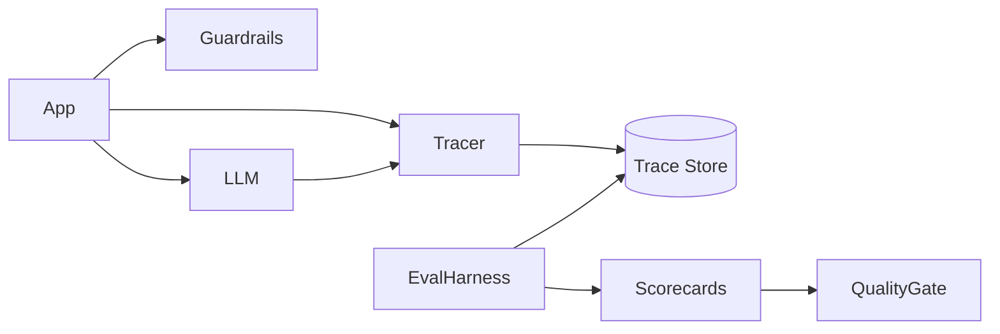

# AI Evaluation & Observability

Reference architecture for **LLM evaluation, tracing, guardrails, and operational metrics** in production AI systems.

## Architecture Focus

- Trajectory and answer evaluation harness
- Guardrail checks (PII, jailbreak heuristics, policy keywords)
- Structured run tracing
- Quality gates for promotion between environments
- Offline + online evaluation seams

## High-Level Architecture



## Key Capabilities

| Module | Purpose |
|---|---|
| Tracer | Correlate prompts, tool calls, and outputs |
| Guardrails | Pre/post checks before side effects |
| Evaluators | Faithfulness, relevance, toxicity stubs |
| Quality gate | Pass/fail thresholds for release |

## Technology Stack

- Python 3.11+
- Pydantic
- pytest

## Setup

```bash
python -m venv .venv
source .venv/bin/activate  # Windows: .venv\Scripts\activate
pip install -r requirements.txt
pytest
python -m src.demo
```

## Example Usage

```python
from src.guardrails.checks import GuardrailPipeline
from src.eval.harness import evaluate_answer

guards = GuardrailPipeline()
assert guards.check_output("Acme revenue grew 12%.").allowed

score = evaluate_answer(
    question="What is the refund window?",
    answer="Refunds are available within 30 days.",
    context="Refunds are available within 30 days of purchase.",
)
print(score.overall)
```

## Security Considerations

- Never log raw secrets in traces
- Separate prod and eval data stores
- Guardrails are necessary but not sufficient

## Known Limitations

- Heuristic evaluators only (no paid judge-model dependency by default)
- Trace store is in-memory

## License

MIT
